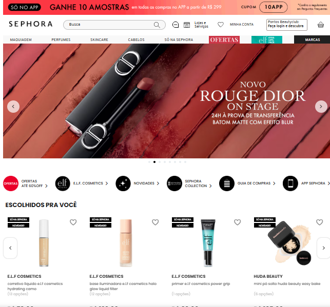
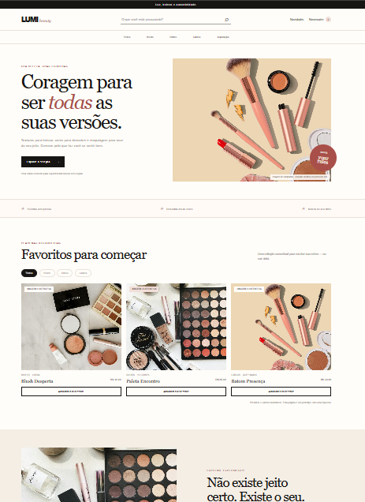

# Pesquisas, fontes e referências visuais

## Inspeção do projeto

Antes da implementação, foi conferida a pasta do projeto. O ponto de partida era um `index.html` mínimo, sem estilos, scripts, fotos ou dependências existentes.

## Referências visuais e de mercado

| Referência | O que observar | Como orientou a LUMI |
|---|---|---|
| [Sephora Brasil](https://www.sephora.com.br/) — referência de categoria indicada para a atividade | Organização de uma loja de beleza, navegação por categorias, busca e apresentação de produtos. | Foram considerados somente padrões gerais de uma vitrine de beleza. A LUMI tem marca, textos, paleta, imagens e composição próprios. Veja a captura fornecida para registro abaixo. |
| Fotografias editoriais de maquiagem — arquivos locais listados em [img/README.md](../img/README.md) | Imagens de produtos, pincéis e retratos com maquiagem. | As fotos foram usadas como conteúdo ilustrativo; não representam produtos nem pessoas associadas à LUMI. |

Os itens da tabela são referências consultadas para orientar o tema e a linguagem visual, não modelos a reproduzir. Não foi feita análise detalhada de páginas da Sephora nem cópia de sua identidade.

### Capturas visuais do projeto

**Referência de categoria — Sephora Brasil**  
Captura fornecida durante o processo. O link acima identifica o site usado como contexto; a imagem registra o exemplo visual compartilhado.

**Resultado da LUMI beauty — captura da página**  
Captura de tela compartilhada durante o processo para documentar a apresentação visual da landing page.

## Pesquisas e fontes utilizadas

| Fonte | Uso no projeto | Observação |
|---|---|---|
| Sephora Brasil | Referência geral da categoria de beleza. | Não foi feita pesquisa de mercado ou análise detalhada do site. |
| Unsplash | Origem dos arquivos fotográficos baixados para a página. | URLs por arquivo estão em [img/README.md](../img/README.md); autoria e licença individual ainda precisam ser verificadas. |
| Captura da referência Sephora | Registro visual da referência compartilhada. | A captura veio da usuária; foi arquivada em `documentacao/referencias-visuais/referencia-sephora.png`. |
| Inspeção dos arquivos locais | Conferência do ponto de partida e dos recursos disponíveis no projeto. | O projeto inicial era uma página HTML mínima. |

Não foram usadas pesquisas de imagens do Google, Coolors ou Google Fonts. A paleta foi definida para o conceito da LUMI e a tipografia usa fontes do sistema, sem carregamento externo.

As capturas fornecidas foram arquivadas junto a este documento em `documentacao/referencias-visuais/`. Elas registram os exemplos compartilhados e não substituem a conferência de origem, autoria ou licença das fotografias usadas no site.

## Referências fotográficas

As imagens do Unsplash foram baixadas para `img/` e são carregadas pela página usando caminhos relativos, por exemplo `img/produtos-maquiagem.jpg`. Portanto, a página não consulta o Unsplash para mostrar as fotos depois que os arquivos estão no projeto.

Os URLs de origem permanecem registrados em [img/README.md](../img/README.md) para permitir rastrear os arquivos e conferir seus termos. Eles são créditos/referências documentais, não caminhos usados pelo HTML.

As imagens foram abertas e inspecionadas visualmente para confirmar o assunto geral. Os nomes dos fotógrafos e as páginas individuais das fotos não foram confirmados, e não foi feita auditoria de licença para uso comercial.

## Direção visual

- Fotografia de cosméticos e retratos em tons quentes e rosados.
- Fundo claro, texto escuro, acento coral e áreas de respiro.
- Títulos serifados com textos e navegação sans-serif.
- Retratos usados como imagens editoriais ilustrativas, sem afirmar que as pessoas retratadas são clientes ou representantes da marca.

## Limites da pesquisa

- Não houve pesquisa com usuários, estudo de conversão ou validação de mercado.
- O catálogo é fictício e não representa produtos reais nem recomendações de maquiagem.
- Algumas fotos mostram embalagens ou marcas de terceiros.
- Antes de publicar, verificar a origem, a licença e a atribuição de cada foto ou substituir por imagens próprias/licenciadas.
